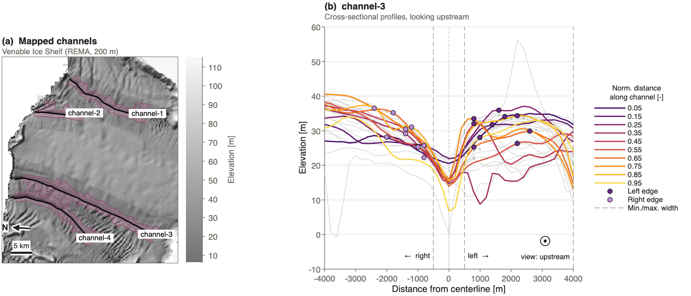

## Sub-Ice: semi-automated mapping of ice shelf basal channels from surface elevation data

**Sub-Ice** (**Su**rface-**b**ased **I**ce Shelf **C**hannel **E**xtraction) is a MATLAB algorithm
for mapping ice shelf basal channels based on their surface expression in a digital elevation model
(DEM). Given a DEM and start and end points for each channel of interest, Sub-Ice maps the channel
centerline, extracts cross-sectional elevation profiles and delineates the channel edges. Channel
width, depth and edge elevation are saved as tables, figures and georeferenced shapefiles.

For a detailed description of the method, please refer to our preprint on arXiv.org:

> Kreynen D, Alley KE, Santis M, Hock R and Jackson PH (2026) Sub-Ice: semi-automated mapping
> of basal channels from ice shelf surface elevation data. arXiv preprint, doi: [coming soon]

All settings are explained in the comments of the configuration file (*config.m*).

<picture>
  <source media="(prefers-color-scheme: dark)" srcset="output/fig_readme_dark.png">
  
</picture>

### Getting started:

1. Install MATLAB with the Mapping and Signal Processing Toolboxes (tested: R2026a).
2. Clone this GitHub repository to create a local copy of the code on your computer (or download and unzip).
3. Open *config.m* and update the settings as required. To write output to disk, set `save_figs`,
   `save_shps` and/or `save_tables` to 1.
4. Run *map_multi_channel.m* in MATLAB, from the Sub-Ice folder.

That's it! All data required to map your first basal channels (four channels on Venable Ice Shelf,
West Antarctica) are included. To map your own channels, point *config.m* to your DEM (GeoTIFF,
projected coordinates in meters) and channel start and end points.

### Contents of this distribution:

  - *map_multi_channel.m*: map one or more channels given a single DEM
  - *map_channel_timeseries.m*: map a single channel over different DEMs
  - *run_batch.m*: run either script for a batch of configuration files
  - *config.m*: configuration file with user specifiable variables
  - *./functions*: collection of custom Matlab functions required to run main scripts
  - *./input*: sample [REMA elevation data](https://www.pgc.umn.edu/data/rema/) and shapefiles with channel start/end points
  - *./output*: sample output (will be overwritten when running main scripts)

### License:

Sub-Ice is released under the MIT License (see *LICENSE*). The sample elevation data in
*input/venable.tif* is a clip of the Reference Elevation Model of Antarctica (REMA) 200 m mosaic,
version 2 (Howat and others, 2022, doi: [10.7910/DVN/EBW8UC](https://doi.org/10.7910/DVN/EBW8UC)),
and is licensed separately under [CC BY 4.0](https://creativecommons.org/licenses/by/4.0/) (see
*input/venable.tif_credit.txt*). *functions/knee_pt.m* is based on a function by Dmitry Kaplan
(MATLAB Central File Exchange, BSD license, see *LICENSE*).

&copy; [Dylan Kreynen](https://www.mn.uio.no/geo/english/people/aca/geohyd/kreynen/)  
University of Oslo  
2024-2026

We thank Adam Isaak (University of Manitoba) for implementing the NearPeaks-Kneedle edge detection methods.

originally a project at the International Summer School in Glaciology\
project team members: Marcelo Santis & Dylan Kreynen\
advisor: Karen Alley (University of Manitoba)\
McCarthy (AK), June 2024
